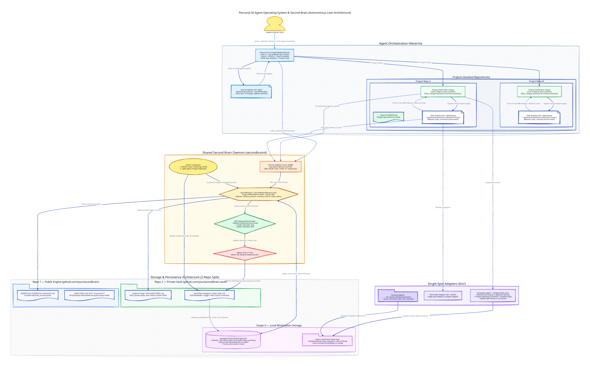

# Second Brain & Agent Operating System

A lean, 100% autonomous, harness-agnostic **Chief of Staff Orchestration & Cross-Project Second Brain** that works identically across **BB**, **Claude Code**, **Codex**, **Pi**, and **Antigravity**.



---

## Core Architecture

1. **Non-Blocking Chief of Staff Hierarchy:**
   * **Global Chief (`tier: heavy`):** Never writes code or runs builds in the main thread—staying 100% responsive in chat while delegating work to isolated background workers.
   * **Universal Ephemeral Worktrees (`bin/spawn-agent`):** Every background task worker (whether a 10-second Fast-Fix or a multi-file Task Architect) runs inside an isolated Git worktree (`<repo>/.worktrees/<slug>`) with symlinked/copy-on-write dependencies (`node_modules`, `.venv`). Zero dirty-WIP collisions, zero `.git/index.lock` races, and zero hard-drive bloat (worktrees are removed the instant they merge).
2. **2-Repo Split (Public Engine + Private Vault):**
   * **Public Engine (`~/.secondbrain`):** Contains 100% of the code, MCP daemon, CLI adapters, universal invariants, and the 5 core OS skills. Locked read-only (`chmod -R a-w`) during normal work and guarded by a Vault-Aware pre-push privacy hook so agents can never leak private data to the public repo.
   * **Private Vault (`~/.secondbrain-vault`):** Your private Git repository storing cross-project `learnings/`, `projects/` charters, custom private `skills/`, and `config/models.yaml`. Uses `* text=auto merge=union` in `.gitattributes` for zero-conflict automatic background syncing across machines.
3. **Local ONNX Vector Daemon (`secondbraind`):**
   * Embeds distilled ~200-token **Index Cards** (`category | title | tags | summary | trigger & invariant`) using `fastembed` (`BAAI/bge-small-en-v1.5`, 67MB, 100% local, zero API keys) into a SQLite WAL database (`storage/memory.db`) and returns the full Markdown file on match in `<5ms`.
   * Lazy-starts automatically on first MCP or CLI call via `flock` (`<200ms`) and auto-exits after 2 hours of idle time.

See [`SYSTEM_DESIGN.md`](SYSTEM_DESIGN.md) for the complete architecture specification.

---

## 1-Command Installation

### Option A: With Your Own Private Vault Repo
```bash
git clone https://github.com/itshady/secondbrain.git ~/.secondbrain
~/.secondbrain/setup.sh --vault git@github.com:<you>/secondbrain-vault.git
```

### Option B: Fresh Local Setup (Auto-Creates a Local Vault)
```bash
git clone https://github.com/itshady/secondbrain.git ~/.secondbrain
~/.secondbrain/setup.sh
```

What `setup.sh` does automatically:
1. Links your Private Vault (`~/.secondbrain-vault`) or initializes a fresh one from `templates/`.
2. Creates `~/.secondbrain/.venv`, pre-warms the local 67MB `bge-small-en-v1.5` ONNX model, and builds `storage/memory.db`.
3. Symlinks `AGENTS.md`, `CLAUDE.md`, and `skills/*` into **BB**, **Claude Code**, **Codex**, **Pi**, and **Antigravity**.
4. Symlinks `bin/*` into `~/.local/bin/` and registers `bin/secondbrain-mcp` across installed harnesses.
5. Installs the Vault-Aware privacy git hook and locks the Public Engine read-only (`chmod -R a-w`).

---

## CLI Reference (`secondbrain`)

```bash
secondbrain status              # Show registered projects, active worktrees & recent completions
secondbrain ps                  # List active/blocked task worktrees across all registered repos
secondbrain prune               # Ancestor-safe cleanup of dead/crashed worktrees
secondbrain search "<query>"    # Semantic search over your Private Vault learnings (<5ms)
secondbrain compact             # Find overlapping notes (>0.85 similarity) for Janitor compaction
secondbrain upgrade             # Pull latest Public Engine + Private Vault & refresh symlinks
secondbrain publish             # Run Vault-Aware privacy scanner & publish Engine changes
```

---

## Universal Agent Bootstrap Prompt (Optional Fallback)

Because `setup.sh` symlinks `AGENTS.md` and `CLAUDE.md` globally into your harnesses, new sessions wake up already knowing your workflow. On a brand-new machine where `setup.sh` hasn't been run yet, paste this into any agent:

```markdown
You are my executive AI Chief of Staff. Ensure `~/.secondbrain` is cloned from `https://github.com/itshady/secondbrain.git`, run `~/.secondbrain/setup.sh`, call `roster_status()` (or `secondbrain status`), read `~/.secondbrain/AGENTS.md`, and report your readiness digest.
```
